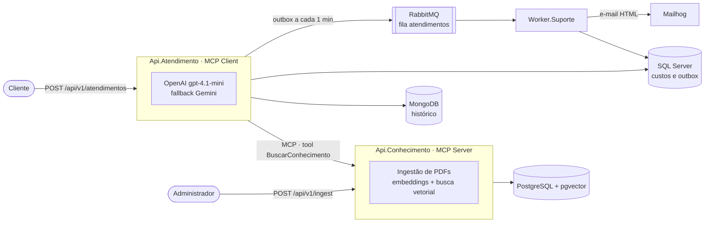

# projeto-ia-infis — CorporativoAI

Solução .NET 10 com um **assistente de IA para dúvidas tributárias e contábeis**. As respostas usam
somente a base de conhecimento da empresa (RAG sobre PDFs ingeridos), a comunicação entre as APIs é
feita por **MCP (Model Context Protocol)**, e atendimentos que precisam de uma pessoa são encaminhados
ao suporte humano por fila e e-mail.

## Visão geral



| Projeto | Responsabilidade |
|---|---|
| [`src/Api.Conhecimento`](src/Api.Conhecimento) | MCP Server. Ingestão de PDFs (`POST /api/v1/ingest`), chunking, embeddings OpenAI e busca vetorial no pgvector exposta pela tool `BuscarConhecimento`. |
| [`src/Api.Atendimento`](src/Api.Atendimento) | MCP Client e orquestrador. Endpoint `POST /api/v1/atendimentos`, prompt do assistente, OpenAI com fallback para o Gemini, memória conversacional, controle de custos e encaminhamento para suporte humano (Semantic Kernel + outbox). |
| [`src/Worker.Suporte`](src/Worker.Suporte) | Worker Service. Consome a fila `atendimentos`, registra cada leitura na inbox e envia o e-mail de novo atendimento para o suporte. |

## Funcionalidades

- **Assistente tributário e contábil**: responde só com base no contexto recuperado e recusa assuntos fora do escopo. A resposta é estruturada (`resposta`, `categoria`, `fontes`, `modelo`, `fallback`, tokens, custo e `encaminharSuporteHumano`).
- **RAG com pgvector**: PDFs (até 2 MB) viram chunks com embeddings `text-embedding-3-small`; a busca usa similaridade do cosseno e ignora documentos com validade vencida.
- **MCP**: a Api.Atendimento obtém o contexto exclusivamente pela tool `BuscarConhecimento` do MCP Server (`/mcp`, transporte HTTP).
- **Fallback**: se a OpenAI falhar, o Gemini `gemini-3.5-flash-lite` responde com o mesmo prompt e o mesmo formato de saída.
- **Memória conversacional**: cada interação é gravada no MongoDB, e as 3 últimas conversas do usuário vão no prompt.
- **Controle de custos**: tokens e custo (entrada, saída e total) de cada requisição no SQL Server.
- **Encaminhamento para suporte humano**: quando o usuário pede uma pessoa ou demonstra insatisfação, uma função do Semantic Kernel grava a solicitação na outbox, que é publicada no RabbitMQ e vira e-mail para o suporte.

## Tecnologias

.NET 10 · ASP.NET Core · ModelContextProtocol · OpenAI SDK · Google.GenAI · Semantic Kernel ·
PdfPig · Npgsql + Pgvector · MongoDB.Driver · Microsoft.Data.SqlClient · RabbitMQ.Client · MailKit ·
xUnit · Docker Compose

## Como executar

### Pré-requisitos

- [.NET 10 SDK](https://dotnet.microsoft.com/download)
- [Docker Desktop](https://www.docker.com/products/docker-desktop/)
- Chave da [OpenAI](https://platform.openai.com/api-keys) e, para o fallback, da [Gemini API](https://aistudio.google.com/apikey)

### 1. Infraestrutura

Na raiz da solução, crie o `.env` a partir do modelo e suba os containers:

```bash
cp .env.example .env
```

```bash
docker compose up -d
```

| Serviço | Endereço | Login |
|---|---|---|
| PostgreSQL + pgvector (RAG) | `localhost:5433` · banco `bd-rag-infis` | `infis` / `infis` |
| pgAdmin | http://localhost:5051 | `infis@email.com` / `infis@2026` |
| MongoDB (histórico) | `localhost:27018` · banco `bd-historico-atendimentos` | `infis` / `infis` |
| Mongo Express | http://localhost:5052 | `infis` / `infis` |
| SQL Server (custos, outbox e inbox) | `localhost,1434` · banco `bd-custos-ia` | `sa` / `Coti@2026` |
| Adminer | http://localhost:5053 | Sistema *MS SQL*, servidor `sqlserver`, `sa` / `Coti@2026` |
| RabbitMQ | `localhost:5672` · painel http://localhost:15672 | `infis` / `infis` |
| Mailhog | SMTP `localhost:1025` · caixa de entrada http://localhost:8025 | — |

Os bancos, tabelas e collections são criados pelos scripts em [`docker/`](docker). As credenciais acima
são **apenas para desenvolvimento local**.

> Se houver um SQL Server instalado na máquina, ele usa a porta `1434` para a conexão administrativa.
> Pare o serviço local (`Stop-Service MSSQLSERVER`, como administrador) antes de subir o container.

### 2. Chaves de API

As chaves **não ficam no repositório** (`"ApiKey": ""` nos `appsettings.json`). Configure-as com
user-secrets:

```bash
dotnet user-secrets set "OpenAI:ApiKey" "<chave-openai>" --project src/Api.Conhecimento
```

```bash
dotnet user-secrets set "OpenAI:ApiKey" "<chave-openai>" --project src/Api.Atendimento
```

```bash
dotnet user-secrets set "Gemini:ApiKey" "<chave-gemini>" --project src/Api.Atendimento
```

Fora do ambiente de desenvolvimento, use as variáveis de ambiente `OpenAI__ApiKey` e `Gemini__ApiKey`.

### 3. Aplicações

Suba a Api.Conhecimento primeiro, porque ela é o MCP Server. Use um terminal para cada aplicação:

```bash
dotnet run --project src/Api.Conhecimento --launch-profile http
```

```bash
dotnet run --project src/Api.Atendimento --launch-profile http
```

```bash
dotnet run --project src/Worker.Suporte
```

| Aplicação | Endereço |
|---|---|
| Api.Conhecimento | http://localhost:5026/swagger · MCP em http://localhost:5026/mcp |
| Api.Atendimento | http://localhost:5255/swagger |

### 4. Uso

Cadastrar um documento na base de conhecimento:

```bash
curl -X POST http://localhost:5026/api/v1/ingest -F NomeUsuario=gabriel -F CodigoDocumento=DOC-001 -F Validade=2027-12-31 -F "Arquivo=@documento.pdf;type=application/pdf"
```

Fazer uma pergunta ao assistente:

```bash
curl -X POST http://localhost:5255/api/v1/atendimentos -H "Content-Type: application/json" -d '{"nomeUsuario":"Gabriel","pergunta":"Quais as principais mudancas da Reforma Tributaria em 2026?"}'
```

Também há exemplos prontos nos arquivos `.http` de cada API (`src/Api.Conhecimento/Api.Conhecimento.http`
e `src/Api.Atendimento/Api.Atendimento.http`).

## Testes

```bash
dotnet test CorporativoAI.sln
```

| Projeto | Cobertura |
|---|---|
| `tests/Api.Conhecimento.Tests` | validação de PDF, extração de texto, chunking, ingestão e similaridade |
| `tests/Api.Atendimento.Tests` | prompt, histórico, custo, saída estruturada, fallback, encaminhamento (Semantic Kernel), publicação da outbox e orquestração |
| `tests/Worker.Suporte.Tests` | leitura da mensagem, modelo do e-mail e processamento (nova, duplicada, falha no SMTP, JSON inválido) |

Os roteiros de teste manual estão nos documentos abaixo.

## Documentação

| Documento | Conteúdo |
|---|---|
| [docs/atendimento.md](docs/atendimento.md) | Fluxo do atendimento, fallback, encaminhamento, memória, custos, resposta e validação |
| [docs/ingest.md](docs/ingest.md) | Ingestão de PDFs: processamento, configuração e testes |
| [docs/worker-suporte.md](docs/worker-suporte.md) | Publicação da outbox, Worker.Suporte, inbox e e-mail |
| [docs/checklist.md](docs/checklist.md) | O que está implementado e o que está pendente |
| [docs/requirementes.md](docs/requirementes.md), [docs/specifications.md](docs/specifications.md), [docs/architecture.md](docs/architecture.md), [docs/tasks.md](docs/tasks.md) | Requisitos, especificações, arquitetura e etapas do projeto |

## Estrutura

```
├── CorporativoAI.sln
├── docker-compose.yml        # infraestrutura local (.env a partir de .env.example)
├── docker/                   # scripts de inicialização dos bancos
├── docs/                     # documentação
├── src/
│   ├── Api.Atendimento/      # MCP Client, assistente, histórico, custos, encaminhamento
│   ├── Api.Conhecimento/     # MCP Server, ingestão de PDFs e RAG
│   └── Worker.Suporte/       # consumidor da fila e envio de e-mails
└── tests/                    # testes unitários (xUnit) de cada projeto
```
