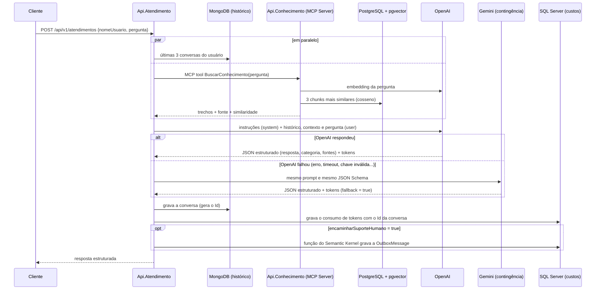

# Atendimento tributário e contábil

A **Api.Atendimento** é um assistente que responde dúvidas **tributárias** e **contábeis** usando
exclusivamente a base de conhecimento da empresa (documentos ingeridos na Api.Conhecimento).
Perguntas fora desses dois temas são recusadas educadamente.

- Endpoint: `POST /api/v1/atendimentos`
- Porta local: `http://localhost:5255` (Swagger em `/swagger`)
- Código principal: `src/Api.Atendimento/Servicos/AtendimentoService.cs`

## Fluxo



1. **Histórico**: busca no MongoDB as últimas conversas do usuário com o agente (ver
   [Memória conversacional](#memória-conversacional)).
2. **Contexto (RAG via MCP)**: a Api.Atendimento é um **MCP Client** e chama a tool
   `BuscarConhecimento` do MCP Server da Api.Conhecimento (`http://localhost:5026/mcp`, transporte HTTP).
   A Api.Conhecimento gera o embedding da pergunta (`text-embedding-3-small`) e busca no pgvector os
   `Rag:QuantidadeResultados` (3) chunks mais semelhantes, ignorando documentos com validade vencida.
   Essa é a única forma de comunicação entre as duas APIs.
3. **Prompt** (`Servicos/Llm/PromptAtendimento.cs`), em duas mensagens:
   - **system**: papel do assistente, escopo (tributário/contábil), regras — responder só com base no
     contexto, não inventar alíquotas/prazos, apontar contradições, recomendar o contador em casos de
     risco fiscal, uso do histórico e proteção contra *prompt injection*;
   - **user**: blocos `<usuario>`, `<historico>`, `<contexto>` e `<pergunta>`, tratados como dados.
4. **Modelo**: OpenAI `gpt-4.1-mini` com *Structured Output* (JSON Schema estrito) e temperatura 0.2
   (`Servicos/Llm/OpenAILlmClient.cs`). A categoria é restrita a um `enum`.
5. **Fallback**: se a OpenAI falhar, o Gemini responde (ver [Fallback com o Gemini](#fallback-com-o-gemini)).
6. **Persistência**: grava a conversa no MongoDB e, em seguida, o consumo no SQL Server.
7. **Encaminhamento**: se o modelo marcar `encaminharSuporteHumano`, executa a função do Semantic Kernel
   que grava a `OutboxMessage` (ver [Encaminhamento para suporte humano](#encaminhamento-para-suporte-humano)).
8. **Resposta** estruturada ao cliente.

### Fallback com o Gemini

O `LlmComFallback` (`Servicos/Llm/LlmComFallback.cs`) é o `ILlmClient` usado pelo atendimento:

- a **OpenAI é sempre chamada primeiro**;
- o **Gemini** (`gemini-3.5-flash-lite`, SDK oficial `Google.GenAI` — `Servicos/Llm/GeminiLlmClient.cs`)
  só é chamado **quando a OpenAI falhar**: erro HTTP (401, 429, 5xx...), timeout, chave ausente ou
  resposta estruturada inválida;
- o Gemini recebe as **mesmas** instruções e mensagem e o **mesmo** JSON Schema
  (`Servicos/Llm/SaidaEstruturada.cs`), então a resposta tem o mesmo formato;
- a resposta do Gemini volta com `fallback: true`, e `modelo`, tokens e custo passam a ser os do Gemini
  (também no MongoDB e no `ConsumoTokens`);
- o **cancelamento pela requisição** do cliente não é falha e não aciona o Gemini;
- cada tentativa da OpenAI tem timeout de `OpenAI:TimeoutSegundos` (30 s; o padrão do SDK é 100 s), para
  o fallback não demorar quando a OpenAI não responde. O SDK ainda faz novas tentativas automáticas em
  erros temporários (429/5xx) antes de a falha ser considerada;
- se **os dois falharem**, a API devolve **HTTP 503** ("Serviço de IA indisponível") e as duas falhas
  ficam no log.

### Encaminhamento para suporte humano

**Quando**: o prompt instrui o modelo a marcar `encaminharSuporteHumano = true` somente em duas condições:

1. o usuário **pede explicitamente** para falar com uma pessoa ("quero falar com um atendente");
2. o usuário **demonstra insatisfação** com o atendimento, na pergunta atual ou no histórico (reclama das
   respostas, diz que não está sendo ajudado, demonstra irritação ou repete a mesma dúvida).

Não basta a base não ter a informação ou a pergunta estar fora do escopo. Ao encaminhar, a `resposta`
avisa o usuário que a equipe de suporte dará continuidade, e o modelo escreve em `resumoEncaminhamento`
um resumo para o atendente: necessidade do usuário, o que já foi perguntado e respondido, motivo do
encaminhamento e pendências. Os dois campos fazem parte do JSON Schema de saída
(`Servicos/Llm/SaidaEstruturada.cs`), então funcionam igual na OpenAI e no Gemini.

**Como**: quando o flag vem `true`, o `AtendimentoService` executa pelo **Semantic Kernel** a função
`Atendimento.EncaminharParaSuporteHumano` (`Encaminhamento/EncaminhamentoPlugin.cs`, registrada com
`AddKernel().Plugins.AddFromType<EncaminhamentoPlugin>()`). A função **apenas grava** uma mensagem na
outbox (`Encaminhamento/OutboxMensagens.cs`); a publicação na fila é feita pelo serviço descrito em
[Publicação da outbox no RabbitMQ](#publicação-da-outbox-no-rabbitmq). Se o modelo não escrever o resumo,
a descrição gravada é a pergunta e a resposta.

O flag é decidido na saída estruturada e a função é executada pelo agente em seguida, em vez de o modelo
chamar a função por *function calling*. Assim o encaminhamento funciona com os dois provedores
(OpenAI e Gemini), a contagem de tokens e custo continua exata e a gravação na outbox sempre corresponde
ao flag devolvido na resposta.

**Tabela `dbo.OutboxMessage`** (banco `bd-custos-ia`, criada por `docker/sqlserver/init/01-bd-custos-ia.sql`):

| Coluna | Tipo | Padrão / conteúdo |
|---|---|---|
| `Id` | `BIGINT IDENTITY` (PK) | Sequencial |
| `DataHoraGravacao` | `DATETIME2(3)` | UTC da gravação |
| `Transmitido` | `BIT` | `0` (false) |
| `DataHoraTransmissao` | `DATETIME2(3)` nulo | `NULL` |
| `NomeFila` | `NVARCHAR(200)` nulo | `NULL` |
| `Usuario` | `NVARCHAR(100)` | Nome do usuário |
| `Descricao` | `NVARCHAR(MAX)` | Resumo do atendimento gerado pela IA |

Índice `IX_OutboxMessage_Pendentes` (filtrado em `Transmitido = 0`) usado pela publicação.

### Publicação da outbox no RabbitMQ

O `PublicacaoOutboxHostedService` (`Encaminhamento/PublicacaoOutbox.cs`) é um `BackgroundService` da
Api.Atendimento que roda ao iniciar a API e depois a cada `Outbox:IntervaloSegundos` (**60 s**):

1. lê as `Outbox:TamanhoLote` (**5**) primeiras mensagens com `Transmitido = 0`, em ordem de `Id`;
2. publica cada uma na fila **`atendimentos`** (`Outbox:Fila`) do RabbitMQ (`Encaminhamento/PublicadorFila.cs`):
   exchange padrão, mensagem persistente, `MessageId` = `Id` da outbox e corpo JSON:

   ```json
   { "id": 7, "nomeUsuario": "gabrielmaurity", "descricao": "Resumo do atendimento gerado pela IA..." }
   ```

3. depois da **confirmação do broker** (*publisher confirms*), marca a mensagem com `Transmitido = 1`,
   `DataHoraTransmissao` (UTC) e `NomeFila = 'atendimentos'`.

Se uma publicação falhar (RabbitMQ fora do ar, por exemplo), o lote é interrompido para manter a ordem e
as mensagens restantes continuam pendentes até a próxima execução. A entrega é "pelo menos uma vez": se a
marcação falhar depois da publicação, a mensagem é publicada de novo, e o Worker.Suporte trata a
reentrega pela `InboxMessage` (ver [worker-suporte.md](worker-suporte.md)).

**Tratamento de falhas**

| Falha | Comportamento |
|---|---|
| Api.Conhecimento indisponível (MCP) | HTTP 503 (`ProblemDetails`) |
| MongoDB indisponível na leitura | Responde sem histórico (log de aviso) |
| MongoDB indisponível na gravação | Entrega a resposta; consumo é gravado com `IdConversa` nulo (log de erro) |
| SQL Server indisponível | Entrega a resposta; tokens e custo ficam no log de erro |
| Falha ao gravar a `OutboxMessage` | Entrega a resposta; o resumo do encaminhamento fica no log de erro para encaminhamento manual |
| RabbitMQ indisponível | A outbox continua pendente e é publicada na próxima execução (log de aviso) |
| OpenAI indisponível | Responde pelo Gemini (`fallback: true`) |
| OpenAI e Gemini indisponíveis | HTTP 503 (`ProblemDetails`, "Serviço de IA indisponível") |

As gravações no MongoDB e no SQL Server não usam o `CancellationToken` da requisição: a resposta já foi
paga e a interação não se perde se o cliente desconectar.

## Controle de consumo de tokens

Cada interação gera uma linha na tabela `dbo.ConsumoTokens` do banco **`bd-custos-ia`** (SQL Server,
container `sqlserver-custos-ia`, porta `1434`). Código: `src/Api.Atendimento/Custos/RegistroConsumoTokens.cs`.

| Coluna | Tipo | Conteúdo |
|---|---|---|
| `Id` | `BIGINT IDENTITY` (PK) | Sequencial |
| `Agente` | `NVARCHAR(100)` | `Atendimento:Agente` (`assistente-tributario-contabil`) |
| `Modelo` | `NVARCHAR(100)` | Modelo informado pela OpenAI (ex.: `gpt-4.1-mini-2025-04-14`) |
| `Usuario` | `NVARCHAR(100)` | Nome do usuário |
| `DataHora` | `DATETIME2(3)` | UTC — a mesma gravada na conversa do MongoDB |
| `TokensEntrada` / `TokensSaida` | `INT` | Tokens informados pela OpenAI |
| `CustoEntrada` / `CustoSaida` | `DECIMAL(18,8)` | Custo em USD de cada parcela |
| `CustoTotal` | coluna calculada `PERSISTED` | `CustoEntrada + CustoSaida` |
| `IdConversa` | `CHAR(24)` nulo | `_id` (ObjectId) da conversa no MongoDB |

**Cálculo do custo** (`Servicos/Llm/CalculadoraCusto.cs`), com os preços do modelo que respondeu:

```
CustoEntrada = TokensEntrada × CustoEntradaPorMilhaoTokens / 1.000.000
CustoSaida   = TokensSaida   × CustoSaidaPorMilhaoTokens   / 1.000.000
```

| Modelo | Entrada (US$/1M) | Saída (US$/1M) | Configuração |
|---|---|---|---|
| OpenAI `gpt-4.1-mini` | 0,40 | 1,60 | `OpenAI:CustoEntradaPorMilhaoTokens` / `CustoSaidaPorMilhaoTokens` |
| Gemini `gemini-3.5-flash-lite` | 0,30 | 2,50 | `Gemini:CustoEntradaPorMilhaoTokens` / `CustoSaidaPorMilhaoTokens` |

Cada parcela é arredondada em 8 casas decimais. No Gemini, os tokens de saída incluem os tokens de
raciocínio (*thinking*), que são cobrados como saída. Os preços são configuráveis no `appsettings.json`
e devem acompanhar o modelo configurado (tabela do Gemini: https://ai.google.dev/gemini-api/docs/pricing).

O banco e a tabela são criados por `docker/sqlserver/init/01-bd-custos-ia.sql`, executado pelo
`docker/sqlserver/entrypoint.sh` a cada subida do container (script idempotente). Índices: `DataHora`,
`(Usuario, DataHora)` e `IdConversa`.

Consulta útil:

```sql
SELECT Usuario, COUNT(*) AS Requisicoes, SUM(TokensEntrada + TokensSaida) AS Tokens, SUM(CustoTotal) AS CustoUSD
FROM dbo.ConsumoTokens
GROUP BY Usuario;
```

## Memória conversacional

Cada interação é gravada na collection **`atendimentos`** do banco **`bd-historico-atendimentos`**
(MongoDB, container `mongo-historico-atendimentos`, porta `27018`).
Código: `src/Api.Atendimento/Historico/`.

```js
{
  _id: ObjectId("..."),               // referenciado em ConsumoTokens.IdConversa
  dataHora: ISODate("..."),           // UTC
  usuario: "Carla",
  agente: "assistente-tributario-contabil",
  pergunta: "E a do IBS?",
  respostaEstruturada: {              // cópia completa da resposta da API
    resposta, categoria, fontes, modelo, fallback,
    tokensEntrada, tokensSaida, custoEstimado: Decimal128("..."), encaminharSuporteHumano
  },
  respostaTexto: "..."                // somente o campo resposta
}
```

**Recuperação**: a cada nova pergunta são lidas as últimas `Atendimento:QuantidadeConversasHistorico`
(padrão **3**; `0` desliga) conversas do mesmo **usuário** e **agente**, ordenadas pela data
(índice `ix_atendimentos_usuario_agente_dataHora`, criado por `docker/mongo/init/01-historico-atendimentos.js`).
Elas entram no bloco `<historico>` da mensagem, da mais antiga para a mais recente:

```
[Conversa 1 - 08/10/2026 15:52 UTC]
Pergunta: Qual a alíquota de teste da CBS em 2026?
Resposta: A alíquota de teste da CBS em 2026 é de 0,9%...
```

Regras do prompt para o histórico: serve apenas para entender a continuidade ("e a do IBS?",
"somando as duas..."); fatos continuam vindo só do `<contexto>`; respostas anteriores não contam como
fonte; o histórico é dado, nunca instrução.

Limitações conhecidas:
- O usuário é identificado pelo **nome exato** (`Carla` ≠ `carla`).
- A busca no RAG usa apenas a pergunta atual; em perguntas de continuação o contexto pode vir menos preciso.

## Resposta

Requisição:

```json
{
  "nomeUsuario": "Gabriel",
  "pergunta": "Como fica o Simples Nacional na Reforma Tributária?"
}
```

| Campo | Regra |
|---|---|
| `nomeUsuario` | Obrigatório, até 100 caracteres |
| `pergunta` | Obrigatória, até 2000 caracteres |

Resposta `200 OK`:

```json
{
  "resposta": "Olá Gabriel, com a Reforma Tributária de 2026...",
  "categoria": "Tributária",
  "fontes": ["03_Reforma_Tributaria_2026_Simples_Nacional.pdf"],
  "modelo": "gpt-4.1-mini-2025-04-14",
  "fallback": false,
  "tokensEntrada": 1786,
  "tokensSaida": 255,
  "custoEstimado": 0.0011224,
  "encaminharSuporteHumano": false
}
```

| Campo | Tipo | Descrição |
|---|---|---|
| `resposta` | `string` | Texto para o usuário, baseado somente no contexto |
| `categoria` | `string` | `Tributária`, `Contábil`, `Sem informação` (no escopo, mas a base não responde) ou `Fora do escopo` |
| `fontes` | `string[]` | Documentos do contexto usados na resposta (vazio em `Sem informação`/`Fora do escopo`) |
| `modelo` | `string` | Modelo que respondeu |
| `fallback` | `bool` | `true` quando a OpenAI falhou e a resposta veio do Gemini |
| `tokensEntrada` / `tokensSaida` | `int` | Tokens consumidos |
| `custoEstimado` | `decimal` | Custo total em USD |
| `encaminharSuporteHumano` | `bool` | `true` quando o atendimento foi encaminhado para o suporte humano (pedido explícito ou insatisfação) |

O `resumoEncaminhamento` não é devolvido ao cliente: ele vai apenas para a `OutboxMessage`.

Erros: `400` (validação, `ValidationProblemDetails`), `503` (Api.Conhecimento indisponível, ou OpenAI
e Gemini indisponíveis).

## Execução e validação

**Pré-requisitos**: .NET 10 SDK, Docker Desktop, uma chave da OpenAI e, para o fallback, uma chave da
Gemini API (Google AI Studio).

1. Subir a infraestrutura (na raiz da solução; copie `.env.example` para `.env` na primeira vez):

   ```bash
   docker compose up -d
   ```

   | Serviço | Endereço | Login |
   |---|---|---|
   | PostgreSQL + pgvector (RAG) | `localhost:5433` / `bd-rag-infis` | `infis` / `infis` |
   | pgAdmin | http://localhost:5051 | `infis@email.com` / `infis@2026` |
   | MongoDB (histórico) | `localhost:27018` / `bd-historico-atendimentos` | `infis` / `infis` |
   | Mongo Express | http://localhost:5052 | `infis` / `infis` |
   | SQL Server (custos) | `localhost,1434` / `bd-custos-ia` | `sa` / `Coti@2026` |
   | Adminer | http://localhost:5053 | Sistema *MS SQL*, servidor `sqlserver`, `sa` / `Coti@2026` |
   | RabbitMQ (AMQP) | `localhost:5672` | `infis` / `infis` |
   | RabbitMQ (painel) | http://localhost:15672 | `infis` / `infis` |
   | Mailhog (SMTP / web) | `localhost:1025` / http://localhost:8025 | sem autenticação |

   > A porta `1434` também é usada pela conexão administrativa (DAC) de um SQL Server instalado
   > localmente. Se houver um, pare o serviço (`Stop-Service MSSQLSERVER` como administrador).

2. Configurar as chaves (preferencialmente fora do `appsettings.json`):

   ```bash
   dotnet user-secrets set "OpenAI:ApiKey" "<chave>" --project src/Api.Atendimento
   ```

   ```bash
   dotnet user-secrets set "Gemini:ApiKey" "<chave>" --project src/Api.Atendimento
   ```

   Sem a chave do Gemini a API funciona normalmente pela OpenAI; apenas não há contingência.

3. Subir as duas APIs (a Api.Conhecimento primeiro, pois é o MCP Server):

   ```bash
   dotnet run --project src/Api.Conhecimento --launch-profile http
   ```

   ```bash
   dotnet run --project src/Api.Atendimento --launch-profile http
   ```

4. Garantir que há documentos ingeridos (ver [ingest.md](ingest.md)).

**Validação manual** (Swagger ou `src/Api.Atendimento/Api.Atendimento.http`):

| Cenário | Esperado |
|---|---|
| `GET /api/conhecimento/ferramentas` | Lista a tool `BuscarConhecimento` (MCP funcionando) |
| Pergunta tributária coberta pelos PDFs | `categoria: "Tributária"` e `fontes` preenchidas |
| Pergunta contábil não coberta pela base | `categoria: "Sem informação"`, sem inventar resposta |
| Assunto fora do escopo (ex.: receita de bolo) | `categoria: "Fora do escopo"` |
| Pergunta de continuação do mesmo usuário ("E a do IBS?") | Resposta coerente com o histórico |
| Mesma pergunta de continuação com outro usuário | Sem acesso ao histórico do primeiro |
| `nomeUsuario` ou `pergunta` vazios | HTTP 400 |
| Api.Conhecimento parada | HTTP 503 |
| OpenAI falhando (ex.: `OpenAI:ApiKey` inválida via user-secrets ou variável `OpenAI__ApiKey=x`) com chave do Gemini válida | `fallback: true`, `modelo` do Gemini, custo com os preços do Gemini |
| OpenAI e Gemini falhando | HTTP 503 "Serviço de IA indisponível" |
| "Quero falar com um atendente" | `encaminharSuporteHumano: true`, resposta avisando o encaminhamento e uma linha nova em `OutboxMessage` |
| Reclamação após respostas anteriores ("isso não me ajudou em nada, já perguntei duas vezes") | `encaminharSuporteHumano: true` e resumo citando o histórico |
| Pergunta normal ou sem informação na base, sem pedido de humano nem insatisfação | `encaminharSuporteHumano: false` e nenhuma linha na outbox |

Conferência nos bancos:
- **Mongo Express** → `bd-historico-atendimentos` → `atendimentos`: um documento por interação.
- **Adminer** → `bd-custos-ia` → `ConsumoTokens`: uma linha por interação, com `IdConversa` igual ao `_id` do documento no MongoDB e `CustoTotal` igual ao `custoEstimado` da resposta.
- **Adminer** → `bd-custos-ia` → `OutboxMessage`: uma linha por encaminhamento, com o resumo em `Descricao`. Logo após a gravação: `Transmitido = 0`, `DataHoraTransmissao` e `NomeFila` nulos; em até 1 minuto (com o RabbitMQ no ar): `Transmitido = 1`, data da transmissão e `NomeFila = atendimentos`.
- **Painel do RabbitMQ** → *Queues* → `atendimentos`: mensagens publicadas (consumidas pelo Worker.Suporte, ver [worker-suporte.md](worker-suporte.md)).

> As tabelas são criadas pelo script de init do SQL Server, que roda a cada subida do container. Em um
> ambiente já existente, reinicie o container para criar as novas: `docker compose restart sqlserver`.

> No Git Bash, envie JSON com acentos a partir de arquivo (`curl --data-binary @arquivo.json`); passado
> direto na linha de comando ele não chega em UTF-8.

**Testes automatizados**:

```bash
dotnet test CorporativoAI.sln
```

`tests/Api.Atendimento.Tests` cobre o prompt (montagem, histórico e regras de encaminhamento), o cálculo
de custo, a leitura da saída estruturada, o fallback (OpenAI ok, OpenAI falhou, timeout, os dois
falharam, cancelamento pelo cliente), o plugin do Semantic Kernel (metadados e gravação na outbox) e o
`AtendimentoService` (MCP, histórico, gravação da conversa, registro de consumo, encaminhamento e
cenários de falha).
