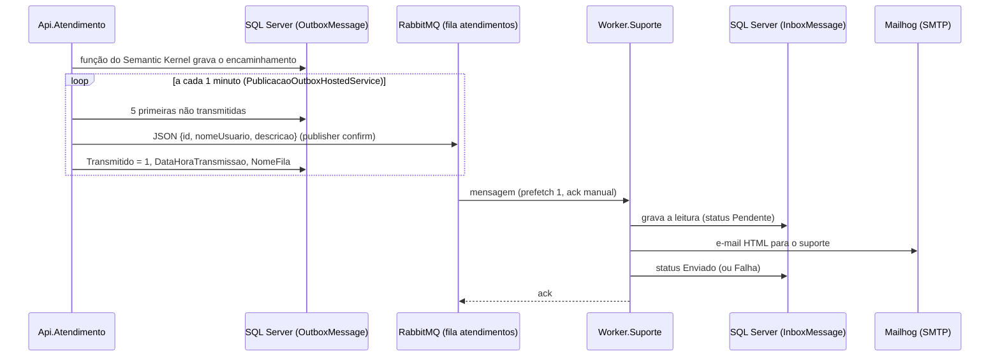

# Worker.Suporte — notificação de encaminhamentos

O **Worker.Suporte** (`src/Worker.Suporte`) é um *Worker Service* que consome a fila **`atendimentos`**
do RabbitMQ e avisa a equipe de suporte, por e-mail, de cada atendimento que o assistente encaminhou
para o suporte humano.

## Fluxo



A publicação da outbox fica na Api.Atendimento e está descrita em
[atendimento.md](atendimento.md#publicação-da-outbox-no-rabbitmq).

## Processamento de cada mensagem

`Processamento/ProcessadorMensagemSuporte.cs`:

1. Lê o JSON (`Mensagens/MensagemAtendimento.cs`). JSON inválido ou sem usuário/descrição → a mensagem é
   **descartada** (`reject` sem devolver à fila) e o erro vai para o log.
2. Verifica se o e-mail dessa mensagem (`MessageId`) já foi enviado em uma leitura anterior.
3. Grava a leitura na **`InboxMessage`** com status `Pendente` — ou `Duplicada`, se o e-mail já tinha sido
   enviado; nesse caso não envia de novo e confirma a mensagem.
4. Envia o e-mail (`Email/EnviadorEmail.cs`, MailKit) e atualiza o status para `Enviado`.
5. Confirma a mensagem na fila (`ack`).

**Falhas**

| Falha | Comportamento |
|---|---|
| SMTP indisponível | Status `Falha`; a mensagem volta para a fila (`nack` com *requeue*) após `RabbitMq:EsperaReprocessamentoSegundos` (15 s) |
| SQL Server indisponível | A mensagem volta para a fila após a mesma espera |
| JSON inválido | Mensagem descartada (log de erro) |
| RabbitMQ indisponível na subida | Nova tentativa de conexão a cada 10 s; depois de conectado, a reconexão é automática |
| Worker encerrado durante o processamento | A mensagem não confirmada volta para a fila |

Cada leitura gera uma linha na `InboxMessage`, inclusive as reentregas — a tabela é o histórico completo
das leituras.

## E-mail

| Campo | Valor |
|---|---|
| Remetente | `worker-service@infis.com.br` (`Email:Remetente`) |
| Destinatário | `atendimento-suporte@infis.com.br` (`Email:Destinatario`) |
| Assunto | `Novo atendimento solicitado por: {usuario}` |
| Corpo | HTML com layout padrão (cabeçalho, tabela com usuário, protocolo e data, resumo destacado e rodapé) + versão em texto |

O layout fica em `Email/ModeloEmailSuporte.cs`: tabelas e CSS inline, compatível com a maioria dos
clientes de e-mail. Usuário e descrição são escapados (`HtmlEncode`) e quebras de linha no nome do usuário
são removidas do assunto. O protocolo é o `Id` da `OutboxMessage`.

## Tabela `dbo.InboxMessage`

Banco `bd-custos-ia`, criada por `docker/sqlserver/init/01-bd-custos-ia.sql`:

| Coluna | Tipo | Conteúdo |
|---|---|---|
| `Id` | `BIGINT IDENTITY` (PK) | Sequencial |
| `IdMensagemFila` | `NVARCHAR(100)` | `MessageId` da mensagem no RabbitMQ (= `Id` da `OutboxMessage`) |
| `DataHora` | `DATETIME2(3)` | UTC da leitura |
| `NomeFila` | `NVARCHAR(200)` | `atendimentos` |
| `Usuario` | `NVARCHAR(100)` | Nome do usuário |
| `Descricao` | `NVARCHAR(MAX)` | Resumo do atendimento |
| `StatusEnvioEmail` | `NVARCHAR(20)` | `Pendente`, `Enviado`, `Falha` ou `Duplicada` |

## Configuração

`src/Worker.Suporte/appsettings.json` e `appsettings.Development.json`:

| Chave | Padrão | Descrição |
|---|---|---|
| `RabbitMq:Host` / `Porta` | `localhost` / `5672` | Servidor RabbitMQ |
| `RabbitMq:Usuario` / `Senha` | `infis` / `infis` | Credenciais (em `appsettings.Development.json`) |
| `RabbitMq:Fila` | `atendimentos` | Fila consumida |
| `RabbitMq:EsperaReprocessamentoSegundos` | `15` | Espera antes de devolver uma mensagem com falha à fila |
| `Email:Host` / `Porta` | `localhost` / `1025` | SMTP do Mailhog (sem TLS e sem autenticação) |
| `Email:Remetente` / `Destinatario` | ver tabela de e-mail | Endereços do e-mail |
| `ConnectionStrings:CustosIa` | `Server=localhost,1434;Database=bd-custos-ia;...` | SQL Server da `InboxMessage` |

Na Api.Atendimento: seções `RabbitMq` (conexão) e `Outbox` (`IntervaloSegundos`, `TamanhoLote`, `Fila`).

Pacotes: `RabbitMQ.Client` 7.2.2, `MailKit` 4.18.1, `Microsoft.Data.SqlClient` 7.1.0.

## Execução e testes

1. Subir a infraestrutura (inclui `rabbitmq-atendimentos` e `mailhog-atendimentos`) e recriar as tabelas
   novas no SQL Server:

   ```bash
   docker compose up -d
   ```

   ```bash
   docker compose restart sqlserver
   ```

2. Subir a Api.Atendimento (publica a outbox) e o Worker:

   ```bash
   dotnet run --project src/Worker.Suporte
   ```

**Validação manual**:

| Passo | Esperado |
|---|---|
| Pedir atendimento humano na Api.Atendimento ("quero falar com um atendente") | Linha nova em `OutboxMessage` com `Transmitido = 0` |
| Aguardar até 1 minuto | `OutboxMessage` com `Transmitido = 1` e `NomeFila = atendimentos`; log "mensagem(ns) da outbox transmitida(s)" na API |
| Painel do RabbitMQ (http://localhost:15672) → *Queues* → `atendimentos` | Mensagem publicada e consumida (fila volta a 0 com o Worker no ar) |
| Mailhog (http://localhost:8025) | E-mail "Novo atendimento solicitado por: {usuario}", de `worker-service@infis.com.br` para `atendimento-suporte@infis.com.br`, com o resumo |
| Adminer → `bd-custos-ia` → `InboxMessage` | Linha com o `IdMensagemFila` igual ao `Id` da outbox e `StatusEnvioEmail = Enviado` |
| Parar o Mailhog (`docker compose stop mailhog`) e encaminhar outro atendimento | Linhas com `Falha` a cada 15 s; ao subir o Mailhog, uma linha `Enviado` e o e-mail aparece |
| Worker parado durante a publicação | Mensagens ficam na fila e são processadas quando o Worker sobe |

**Testes automatizados** (`tests/Worker.Suporte.Tests`):

```bash
dotnet test tests/Worker.Suporte.Tests
```

Cobrem a leitura do JSON, o modelo do e-mail (assunto, conteúdo, escape de HTML, proteção do assunto) e o
processamento (mensagem nova, duplicada, falha no SMTP, JSON inválido, mensagem sem `MessageId`). A
publicação da outbox é coberta em `tests/Api.Atendimento.Tests/Encaminhamento/ProcessadorOutboxTests.cs`.
